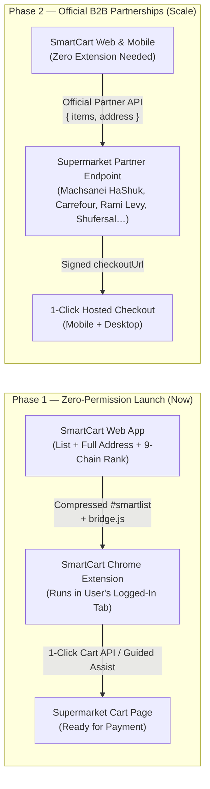
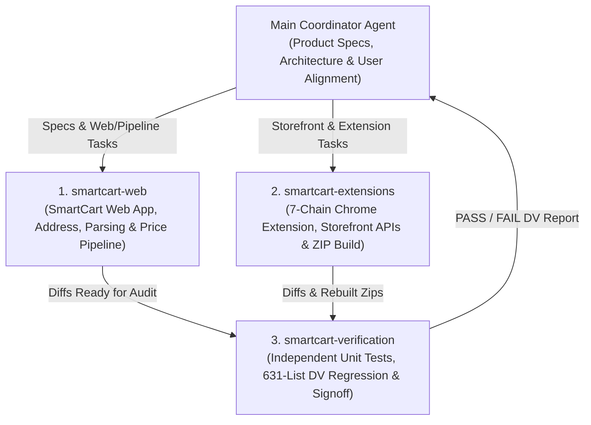

# SmartCart (העגלה החכמה) — Project Goal, Strategy & Master Agenda

> **One-Sentence Mission:** Let any Israeli household paste or build their grocery list once, enter their home address, see the **true cheapest basket across major and mid-size chains**, and transfer the **entire list straight into the chosen supermarket's online cart** ready for payment.

---

## 1. The Product & Core Idea

Shopping for groceries online in Israel today is broken in two places:
1. **Price opacity across chains:** A family basket that costs ₪740 on one chain can cost ₪610 on a mid-size challenger chain in the exact same neighborhood—once real promotions, weighted produce, and delivery fees are counted honestly.
2. **Cart lock-in (the 40-item wall):** Even if a shopper discovers another supermarket is ₪130 cheaper, nobody will manually search and click 35–50 products all over again on a new website every week.

**SmartCart (`העגלה החכמה`) solves both halves end to end:**

1. **Zero-Friction List Capture (< 60 Seconds):**
   - Paste messy WhatsApp family messages, free-text Hebrew lists, CSV/TSV, Google Sheets links, or styled `.xlsx` spreadsheets (preserving strike-through / `✅` bought items).
   - Understands natural Hebrew morphology, brands, units, ambiguous generic terms (`שמן`, `קמח`, `פלפל` → 1-click disambiguation chips), and **realistic Israeli weighted-produce math** (`"3 גזרים"` → `0.36 kg`, bare `"גזר"` → `1.0 kg`, `"שום"` → `0.25 kg`, with 1-click UI pills to switch between pieces, kg, or packs).
2. **Full Address-Aware Comparison Across 9 Chains (Top-Down Ranked List):**
   - Ingests official Israeli **Price Transparency Law (`חוק שקיפות מחירים`)** feeds (`Stores`, `PriceFull`, `PromoFull`) across **9 chains**—combining national giants (**Shufersal**, **Rami Levy**, **Carrefour / Quik**) with hungry mid-size and discount chains (**Machsanei HaShuk**, **Victory**, **Yochananof**, **Tiv Taam**, **Keshet Teamim**, **Osher Ad**).
   - Displays a **single vertical top-down ranked list** ordered strictly by completeness first (`33/33` complete baskets before partial baskets) and true out-of-pocket price second—never inventing missing prices and never crowning a partial basket "cheapest".
3. **Whole-List Cart Handoff ("Ready for Payment"):**
   - Transfers the **entire shopping list** directly into the selected supermarket's online cart, safely merging with any items already in the cart and landing the user on the supermarket's cart/checkout page so all that remains is choosing a delivery slot and paying.

---

## 2. Critical Requirement: User Address Inside SmartCart

**SmartCart must collect, validate, and remember the shopper's full address (`עיר`, `רחוב`, `מספר בית`, `דירה / קומה`, plus delivery vs. pickup mode) directly inside our website.**

Why full address support inside SmartCart is foundational—not just a city dropdown:

| Reason | Why City Alone Is Not Enough | What Full Address in SmartCart Unlocks |
| :--- | :--- | :--- |
| **1. Real Delivery Coverage** | Chains deliver by polygon / street zone, not whole municipalities. | Filters and badges which online chains actually deliver to the user's exact street before they waste time checking out. |
| **2. Warehouse & Branch Pricing** | Online orders ship from specific regional dark-stores or fulfillment branches with distinct stock and promos. | Matches the user's basket against the exact fulfillment store serving their address (and ranks nearby physical branches like Osher Ad / Yochananof by real distance). |
| **3. Smooth Cart Fill & Slot Readiness** | Supermarket backends (Shufersal Hybris, Rami Levy, Self-Point) tie cart stock validation and delivery fees to an active delivery address on the session. | Passes structured address context into the cart-handoff flow, warns early if the supermarket session has no delivery address selected, and pre-fills address/login hints where supported. |
| **4. Official B2B Partner API Contract** | Retailer cart-creation APIs require `{ items, address }` to allocate warehouse inventory and generate a checkout URL. | Makes SmartCart plug-and-play ready for official server-to-server supermarket partnerships. |

---

## 3. Competitive Landscape in Israel & Why We Win

### Existing Players & Their Gaps

| Competitor / Category | What They Do Well | Where They Fall Short |
| :--- | :--- | :--- |
| **CHP (`chp.co.il`)** | Veteran database of physical-store XML prices across Israel; barcode lookup. | Legacy desktop UX; no WhatsApp/Sheets smart list import; **cannot copy or inject your basket into any supermarket's online cart**. |
| **Pricez (`pricez.co.il`)** | Mobile barcode scanner and basket price comparison on transparency feeds. | Stops at showing comparison numbers; shoppers still face manually rebuilding a 40-item cart on the supermarket website. |
| **MySupermarket Israel *(shut down 2020)*** | Proved massive Israeli consumer appetite for "build once → send cart to Shufersal / Rami Levy". | Shut down globally in 2020, leaving an **unfilled vacuum in Israel** for consumer list-to-cart checkout. |
| **Single-Chain Developer Bots (`Salchik`, `shufersal-automation`, etc.)** | Prove that supermarket web APIs (`Hybris`, `Self-Point`, `Rami Levy`) support programmatic cart building. | Developer-only CLI/Puppeteer scripts for a single chain; require credentials in `.env` files; unusable for regular consumers. |

### SmartCart's Unfair Advantages

1. **List → Live Cart (Solving the Last Mile):** Competitors compare spreadsheets; SmartCart **fills the supermarket cart** so switching to a cheaper chain takes **one click instead of 25 minutes**.
2. **Mid-Size & Challenger Chains Wedge (`מחסני השוק`, `ויקטורי`, `קרפור/קוויק`, `יוחננוף`, `טיב טעם`, `קשת טעמים`):**
   - Note on **Quik (`קוויק`)**: Acquired 100% by Electra Consumer Products and folded into **Carrefour Israel's** online delivery operation (`carrefour.co.il` on Self-Point).
   - While giant incumbents have little incentive to help users price-shop, mid-size chains spend heavily on customer acquisition (`CAC`). Sending them high-intent ₪600–₪1,000 family baskets makes SmartCart an immediate revenue partner for challenger chains first—building the traffic volume that compels the largest chains to partner next.
3. **Honest Hardware-Verified Pricing:** Backed by a 631-list Design-Verification (DV) testbench with an independent XML oracle (`99%+` precision/recall, `100%` honesty invariants).

---

## 4. Two-Phase Architecture & Business Roadmap

### Phase 1: Browser Extension Bridge (No Supermarket Permission Needed)
- **Why an extension is technically required today:** Browser Same-Origin Policy (`CORS`), `HttpOnly` session cookies, anti-CSRF tokens, and WAFs (`Imperva` / `Cloudflare`) prevent any external website from directly mutating a user's cart on `shufersal.co.il` or `rami-levy.co.il` without the retailer's cooperation.
- **How our unified modular extension solves it cleanly:**
  - **One lightweight install** (`extension/` — internally modularized per chain under `extension/chains/<chain>.js`, with per-chain build artifacts also supported via `extension/build.mjs --all-chains`).
  - **4 Full 1-Click Auto-Fill Chains:** `Shufersal`, `Rami Levy`, `Carrefour`, `Machsanei HaShuk`.
  - **3 Guided Search-and-Add Chains:** `Victory`, `Yochananof`, `Tiv Taam` (with single-match DOM highlight assist).
  - **Strict Privacy:** Never touches or stores passwords; user logs in normally once on the supermarket tab (browser password manager keeps session alive), and SmartCart remembers non-sensitive email/phone hints + product mappings.

### Phase 2: Official Retailer Cart-Handoff Partnerships (Extension-Free)
- Once SmartCart demonstrates repeatable weekly basket volume:
  1. Sign B2B cart-handoff / affiliate agreements starting with challenger chains (**Machsanei HaShuk**, **Carrefour**, **Victory**, **Yochananof**, **Tiv Taam**) and expanding to **Rami Levy** and **Shufersal**.
  2. Replace client-side extension calls on partnered chains with an official server-to-server `POST /partner/create-cart` (`{ items, deliveryAddress }` → `checkoutUrl`), unlocking **zero-install mobile & desktop checkout** and per-order affiliate commission.

---

## 5. Master Project Agenda (Prioritized Backlog)

### Priority 1 — Full Address Engine in SmartCart Website (`Next Immediate Sprint`)
- [ ] Replace city-only picker with a **Full Delivery Address bar & modal** in `web/`:
  - Fields: **City (`עיר`)**, **Street (`רחוב`)**, **House Number (`מספר בית`)**, **Apartment / Floor (`דירה / קומה`)**, and **Shopping Mode (`משלוח עד הבית` vs `איסוף / קנייה בסניף`)**.
  - Persist cleanly in `web/js/store.js` (`localStorage`) so returning users see their address immediately.
- [ ] Connect address to **delivery-zone eligibility & nearest-branch selection** (`delivery-coverage.json` + store coordinates/city matching).
- [ ] Include non-sensitive structured address metadata in the handoff payload (`codec.js`) so the Chrome Extension can display/verify that the supermarket tab's delivery zone matches the user's SmartCart address.

### Priority 2 — Bulletproof 7-Chain Cart Handoff & Chrome Web Store Release
- [ ] Live end-to-end QA across all 4 `'auto'` chains (**Shufersal `v3.1.2`**, **Rami Levy**, **Carrefour**, **Machsanei HaShuk**), verifying barcode translation (`72900...` ↔ `P_<short>`, EAN ↔ `ramiId`, EAN ↔ `retailerProductId`), weighted produce quantities, and per-item `500` isolation.
- [ ] Research & upgrade **Victory**, **Yochananof**, and **Tiv Taam** from `'guided'` toward automated cart injection where platform APIs allow safe merging.
- [ ] Publish the unified **SmartCart Chrome Extension** to the **Chrome Web Store** so users install in 1 click without `.zip` developer mode.

### Priority 3 — Daytime Price Pipeline Automation & 800+ Branch Coverage
- [ ] Run automated daytime refreshes (`pipeline/build.mjs` + `publish-pages.mjs`) outside midnight portal rollover windows so `mahsaneihashuk`, `victory`, and `osherad` publish their full ~60–90 store lists alongside `shufersal` (`416`), `carrefour` (`147`), `ramilevy` (`97`), `tivtaam` (`54`), `yochananof` (`47`), and `keshet` (`25`).
- [ ] Expand human-verified delivery fees & free-shipping thresholds in `web/data/delivery.json` across all 7 online chains.

### Priority 4 — Smart Account Ergonomics, Retention & Partner Readiness
- [ ] Streamlined account-hint & address onboarding inside SmartCart (email/phone autofill on supermarket login pages, zero password handling).
- [ ] Mobile-to-Desktop instant basket sync / WhatsApp self-link + smart recurring household restock suggestions.
- [ ] Anonymous conversion & basket-value telemetry (opt-in / privacy-safe) to power B2B partnership pitches to Israeli supermarket chains.

---

## 6. AI Engineering Infrastructure: 3-Agent Team Model

To stop ad-hoc cross-cutting edits and regressions, development in `smart-grocery` is partitioned across **three specialized subagents** coordinated by the main architect agent:

| Agent ID | Owned Directories | Strictly Forbidden From Editing | Core Responsibility |
| :--- | :--- | :--- | :--- |
| **`smartcart-web`** | `web/**` *(except extension zips)*, `pipeline/**`, `api/**`, `serve.mjs` | `extension/**`, `tests/regression/refmodel/**` | SmartCart UI, full address & delivery-zone engine, list/Sheets/XLSX importers, weighted produce, honest 9-chain pricing & ranking, transparency XML pipeline. |
| **`smartcart-extensions`** | `extension/**`, `web/smartcart-extension.zip`, `web/shufersal-extension.zip` | `web/js/**` *(except syncing `codec.js`)*, `pipeline/**`, `tests/regression/refmodel/**` | Unified & per-chain MV3 Chrome extensions across all 7 online chains, `AbortController` timeouts, barcode-to-catalog resolution, fault-tolerant cart merging, checkout navigation. |
| **`smartcart-verification`** | `tests/**`, `tests/regression/**`, `.agents/skills/dv-regression/**`, `.agents/rules/**` | Production code in `web/**`, `extension/**`, `pipeline/**` | Hardware-DV-style independent verification: writes adversarial unit & directed tests, maintains independent reference models (`<= 30%` lexicon overlap), runs `npm test` + `npm run regression`, and blocks unverified releases. |
