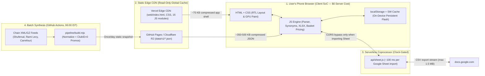
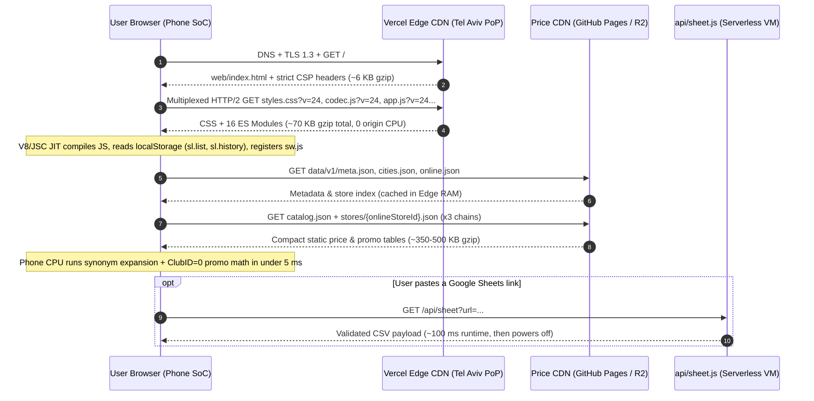
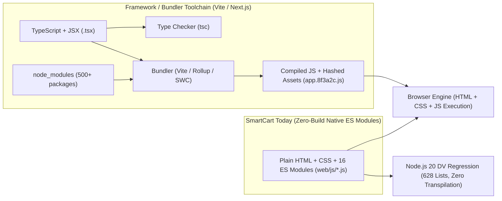
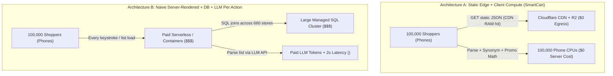
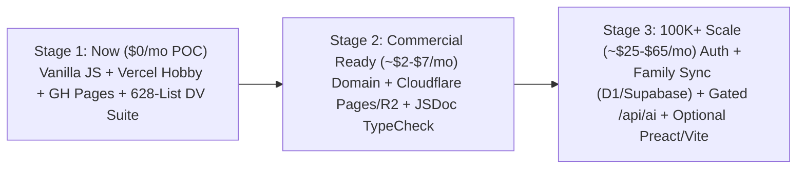

# Web Architecture & Cloud Economics Guide for SmartCart

> [!NOTE]
> **Written for Hardware & Design Verification (DV) Engineers.** This guide strips away web-framework hype and explains how SmartCart (`smart-grocery`) actually executes at the network, memory, and CPU levels — why our current architecture handles massive traffic for pennies, what React/TypeScript/Next.js actually do under the hood, and what 100,000+ users really cost.

---

## 1. How a Web App Actually Runs (Hardware Mental Model)

In chip design, you partition a system across specialized execution blocks: local compute cores, read-only instruction/data caches, clock-gated coprocessors, and offline synthesis jobs. SmartCart is partitioned the exact same way.

### End-to-End Architecture: The 4 Execution Zones

### Physical Boot Sequence: Opening `https://smart-grocery-kappa.vercel.app`

When a shopper taps the SmartCart link on an iPhone or Android phone in a supermarket aisle, here is what physically happens on the wire and silicon:

1. **DNS + TLS + Edge Routing (`~30–80 ms`):** The phone resolves `smart-grocery-kappa.vercel.app` via Anycast DNS to the nearest Vercel Edge Point-of-Presence (PoP) and completes a TLS 1.3 handshake. `vercel.json` rewrites `/` to `/web/index.html` and attaches strict `Content-Security-Policy` headers (`script-src 'self'`, `object-src 'none'`).
2. **App Shell Fetch (`~50–150 ms` on 4G):** The browser parses `<html lang="he" dir="rtl">`, fetches `styles.css?v=24`, `js/codec.js?v=24`, and the ES module graph rooted at `js/app.js?v=24` (`16` `.js` files totaling `~270 KB` uncompressed, or **`~65–80 KB` compressed on the wire** via Brotli/Gzip over multiplexed HTTP/2).
3. **Service Worker Installation (`web/sw.js`):** On first load, `sw.js` caches only the static app shell (`index.html`, `styles.css`, `manifest.webmanifest`, `icon.svg`) using a **network-first, offline-fallback** policy. Crucially, line 30 of `sw.js` explicitly bypasses `/api/*` and `/data/*` so the Service Worker can **never** serve stale supermarket prices.
4. **Local State Hydration (`<1 ms`):** `web/js/store.js` reads the user's shopping list (`sl.list`), purchase-frequency history (`sl.history`), product mappings (`sl.mappings`), and category overrides (`sl.catOverrides`) directly from the phone's `localStorage`.
5. **Price Feed Hydration (`~100–250 ms`):** `web/js/prices.js` fetches `meta.json`, `cities.json`, `online.json`, each chain's `catalog.json`, and the active branch's `<storeId>.json` (defaulting to official `StoreType=2` online stores: Shufersal `413`, Rami Levy `39`, Carrefour `471/472/473`, or the chosen physical branch when toggled).

---

### Deep Dive into Each Execution Zone

#### Zone 1: User's Browser ("Edge ASIC / Client SoC")
Every modern smartphone carries a multi-core ARM SoC (Apple A-series / Snapdragon) that is faster than a 2018 server Xeon, plus gigabytes of LPDDR5 RAM and NVMe flash. A web app ships four primitives to that device:
- **HTML (`web/index.html`):** Structural netlist of UI elements (buttons, inputs, `<dialog>` modals) converted by the browser into an in-memory tree called the **DOM** (Document Object Model).
- **CSS (`web/styles.css`):** Declarative layout and styling constraints (`dir="rtl"`, flexbox/grid geometry, dark/light colors) rasterized on the phone's GPU.
- **JavaScript (`web/js/*.js`):** Behavioral logic JIT-compiled to native ARM64 machine code by Chrome's V8 or Safari's JavaScriptCore engine.
- **`localStorage` (`web/js/store.js`):** Per-origin synchronous key-value flash storage (`~5 MB` quota per domain) stored on the user's device. Because a 100-item grocery list plus a year of purchase history is only `~15–40 KB` of JSON, `localStorage` gives instant persistence with zero database servers.

> [!TIP]
> **Why 99% of SmartCart's CPU Work Costs `$0`:** Every messy WhatsApp paste (`parser.js`), Excel `.xlsx` ZIP/XML stream decompression (`zip.js`, `xlsx.js`), Hebrew morphological root/plural expansion (`prices.js`, `synonyms.js`), and multi-chain bundle promotion calculation (`pricing.js`) executes **on the shopper's own phone CPU**. When 50,000 shoppers edit lists simultaneously on Thursday afternoon, 50,000 phones supply 50,000 CPUs for free. Our server CPU load remains **zero**.

#### Zone 2: Static CDN ("Global Read-Only L2/L3 Cache")
Both our frontend code (Vercel CDN) and our compiled price snapshots (`data/v1/` on GitHub Pages' Fastly CDN today, or Cloudflare R2 tomorrow) are **immutable static files**.
- **Hardware analogy:** Serving static JSON from a CDN is **DMA / zero-copy `sendfile()` out of edge router RAM**, *not* executing a dynamic program per request.
- When User #1 in Tel Aviv requests `data/v1/shufersal/stores/413.json`, the Tel Aviv CDN edge node caches the compressed byte buffer in RAM. Users #2 through #100,000 receive that exact pre-compressed buffer straight from edge memory in `<15 ms` with virtually zero origin compute.

#### Zone 3: Serverless Function ("Clock-Gated On-Demand Coprocessor")
Look at `api/sheet.js` (`97` lines of Node.js). Why does this file run on a server when everything else runs in the browser?
- **The Browser CORS Boundary:** For security, browsers enforce the **Same-Origin Policy (CORS)**. JavaScript running on `https://smart-grocery-kappa.vercel.app` is forbidden from reading raw HTTP responses from `https://docs.google.com/spreadsheets/.../export?format=csv` unless Google explicitly stamps an `Access-Control-Allow-Origin` header (which Google Sheets export redirects do not reliably grant to arbitrary web origins).
- **Server-to-Server Fetch Has No CORS:** `api/sheet.js` acts as a tiny, strict proxy coprocessor:
  1. Validates the spreadsheet ID regex (`extractSheetExportUrl`).
  2. Restricts outbound redirects strictly to `*.google.com` / `*.googleusercontent.com` (preventing Server-Side Request Forgery / SSRF).
  3. Caps payload size at `1.5 MB` and rate-limits callers to `40 req/min` per IP.
  4. Streams back `{ csv }` in `~80–150 ms` and immediately powers down.
- **Cost model:** Like a clock-gated hardware accelerator, a Serverless Function consumes **`$0` when idle**. You are billed only for the milliseconds it is actively awake.

#### Zone 4: Scheduled Batch Pipeline ("Nightly Synthesis Job")
Instead of querying supermarket XML feeds or a heavy SQL database on every user request, `.github/workflows/prices.yml` runs `node pipeline/build.mjs --out=data/v1` once a day at `04:00 UTC` (`06:00 IST`, right after Shufersal and Carrefour publish morning price dumps):
- Downloads compressed `Stores`, `PriceFull`, and `PromoFull` XML/GZ archives across **~660+ branches** and **117 CBS localities**.
- Decodes mixed encodings (`UTF-8`, `UTF-16LE`, `Windows-1255`), normalizes barcodes, extracts active all-customer promotions (`ClubID = 0`), and emits compact per-chain `catalog.json` + per-branch `<storeId>.json` lookup tables (`~3 minutes` wall-clock build).
- **Hardware analogy:** This is **RTL-to-gate synthesis / ROM table generation**. Doing the `O(Chains × Branches × Items)` work once offline turns every runtime user session into a cheap `O(BasketSize)` hash-table lookup on the phone.

---

## 2. JavaScript vs React vs TypeScript vs Next.js — Honest Pros & Cons

### First Principle: Browsers Only Execute HTML + CSS + JavaScript

If you inspect the instruction set of any mobile or desktop browser (Chrome Blink/V8, Safari WebKit/JSC, Firefox Gecko/SpiderMonkey), **none of them understand TypeScript, JSX, React, Vue, Angular, or Svelte**. Every modern web framework and language is a **compile-time abstraction + runtime library** that compiles down to standard JavaScript and CSS before shipping to the phone:

Think of **HTML + CSS + Vanilla JS** as **synthesizable SystemVerilog**, whereas **TypeScript + React + Vite** is **Chisel / Bluespec + a synthesis bundler**: higher-level ergonomics and stronger compile-time checks, at the price of a build pipeline between your source files and execution.

---

### 2.1 What SmartCart Uses Today: Vanilla ES Modules (Zero Build, Zero `npm` Dependencies)

Look at `package.json`: it is literally **one line** with zero `dependencies` and zero `devDependencies`. `web/index.html` loads ``, and the browser natively resolves `import` statements across `16` modular `.js` files.

#### Genuine Engineering Strengths
1. **Zero Supply-Chain & Build Rot:** A standard React/Next.js repo pulls `500–1,200` transitive packages into `node_modules`. Leave it untouched for 8 months and you come back to 19 `npm audit` CVEs and broken bundler plugins. SmartCart can be cloned onto any machine with Node 20+ five years from now and `npm test` + `npm start` will pass in seconds.
2. **Tiny Wire Payload (`~65–80 KB` compressed):** Supermarket aisles (especially underground floors in Israel) are notoriously hostile RF environments (1 bar of 4G, high packet loss). Shipping zero framework runtime means SmartCart boots and becomes interactive in `<300 ms`.
3. **1:1 Isomorphic DV Testbench Reuse (`tests/regression/`):** Because `parser.js`, `importer.js`, `synonyms.js`, `xlsx.js`, `prices.js`, and `pricing.js` are pure standard ES modules with zero JSX or bundler magic, Node.js imports the **exact production files** directly against our 628-list regression suite (`108` directed corner cases + `520` seeded constrained-random baskets checked against a standalone XML oracle).

#### Genuine Engineering Weaknesses
1. **Imperative DOM State Sync (`web/js/app.js` is already `~72 KB`):** Without a declarative UI layer, updating the screen requires imperative DOM mutations (`el.hidden = ...`, `innerHTML`, manual event listener wiring).
   - **DV analogy:** Imperative DOM code is like **hand-coding gate-level FSM output transitions**. With 4 states, hand-coding is crystal clear; with 25 interacting states (delivery vs branch mode, city autocomplete, disambiguation chips, family sync banner, auth modals, item drawers), forgetting one signal assignment on one transition leaves stale UI on screen.
2. **Manual Cache-Busting (`?v=24` in `web/index.html`):** Bundlers like Vite automatically hash every file by content (`prices.a91f02.js`) so browsers cache forever and invalidate atomically on change. Today we bump `?v=24` manually on top-level tags.
3. **No Compile-Time Type Elaboration:** Passing `undefined` or `"2"` (string) instead of `2` (number) across module boundaries is caught only when a unit/regression test exercises that code path, rather than instantaneously at compile/save time.

---

### 2.2 What React (or Preact / Vue / Svelte) Actually Does

React solves **one specific problem**: keeping complex, stateful UI trees synchronized with data via a declarative formula:

`UI = f(state)`

Instead of writing transition deltas (*"when user clicks `modeStore`, hide `deliveryOptions`, show `branchPickers`, change `locLabel`..."*), you write a pure render function describing what the UI looks like for *any* `state`, and React diffs its lightweight Virtual DOM tree to apply the minimal real DOM updates.
- **Hardware analogy:** Behavioral RTL (`always_comb` synthesis from truth tables) vs manually wiring muxes and flip-flop enables for every state transition.
- **Trade-offs:**
  - `react` + `react-dom` adds `~45 KB` gzipped of framework runtime before a single line of your app loads (**Preact** gives 95% of the same React API in **`~4 KB` gzipped**; **Svelte** compiles components away at build time).
  - Requires a build step (`Vite`) and `node_modules`.
  - **Architectural rule if we ever adopt it:** Only `web/js/app.js` (the view layer) should ever touch React/Preact. Domain engines (`parser.js`, `synonyms.js`, `prices.js`, `pricing.js`, `xlsx.js`) must remain pure, framework-free `.js`/`.ts` modules so the DV regression suite never slows down or depends on a UI framework.

---

### 2.3 What TypeScript Actually Does (Plus the Zero-Build JSDoc Shortcut)

TypeScript is JavaScript plus a **static type system** checked at compile time and **100% erased** before execution:
- **Hardware analogy:** **SystemVerilog elaboration (`verilator --lint-only` / `vcs`)** vs Verilog-1995 implicit `wire` nets or untyped Python. TypeScript catches port mismatches (`storeId: number` passed where `storeId: string` is expected), missing struct fields, and unhandled `null` branches in `<1 second` in your editor before running tests.
- **What TypeScript does NOT do:** It adds **zero runtime speed** and **zero runtime validation** on untrusted JSON coming over the network (you still need runtime sanitizers like `store.importAll()` and `SLCodec.sanitizeProduct()`).

> [!IMPORTANT]
> **The Pragmatic Middle Ground (`JSDoc + tsc --noEmit`):** You do **not** have to rename `.js` files to `.ts` or introduce a build bundler to get TypeScript's static verification! Adding a 10-line `jsconfig.json` with `"checkJs": true` and `/** @typedef ... */` comments lets `tsc --noEmit` statically type-check plain `.js` files in CI while keeping **zero build step** in production and in `tests/regression/`.

---

### 2.4 What Next.js Actually Is (and Why SmartCart Doesn't Need It)

**Next.js** is a full-stack framework that runs React **on cloud servers** (Server-Side Rendering / React Server Components) to generate HTML dynamically per HTTP request.
- **When Next.js shines:** Content-heavy public websites with 100,000 distinct URLs that Google's search crawler must index individually (news sites, public e-commerce catalogs, documentation).
- **Why it is counterproductive for SmartCart:** SmartCart is an interactive, single-screen utility PWA (`העגלה החכמה`) where the user's list is private. Moving rendering from the user's free phone CPU onto Next.js serverless functions **increases cloud bills**, adds server cold-start latency, complicates offline PWA caching in low-signal supermarkets, and couples you tightly to paid server compute.

---

### 2.5 Stack Decision Matrix & Migration Triggers

| Dimension | 1. Vanilla JS ES Modules *(Current)* | 2. Vanilla JS + JSDoc TypeScript *(`tsc --noEmit`)* | 3. Preact / React + Vite + TS *(Client SPA)* | 4. Next.js *(Full-Stack SSR React)* |
| :--- | :--- | :--- | :--- | :--- |
| **Build Step Required?** | **None** (edit & reload) | **None** (`tsc` runs read-only in CI/IDE) | **Yes** (`vite build` -> static `dist/`) | **Yes** (server + client bundles) |
| **`npm` Dependencies** | **`0`** | **`1` dev-only** (`typescript`) | `~15–40` dev/prod packages | `~200–600+` packages |
| **Wire Payload (Gzip/Brotli)** | **`~65–80 KB`** | **`~65–80 KB`** | `~75 KB` (Preact) / `~115 KB` (React) | `~130–220 KB+` |
| **Compile-Time Type Safety** | None (covered by unit + DV tests) | **High** (struct/port mismatches caught statically) | **Highest** (full `.ts` / `.tsx` strict mode) | **Highest** (end-to-end `.ts` / `.tsx`) |
| **Complex UI State Ergonomics** | Manual FSM (`app.js` grows linearly/quadratically) | Manual FSM (safer interfaces, same DOM code) | **Declarative `UI = f(state)`** (scales cleanly to 30+ views) | Declarative + Server Components |
| **Offline Supermarket PWA** | **Trivial & rock-solid** | **Trivial & rock-solid** | **Clean** (`vite-plugin-pwa`, still 100% static CDN) | **Complex** (SSR routes fail offline without custom caching) |
| **Hosting Cost @ 100K MAU** | **`$0–$5/mo`** (Static CDN) | **`$0–$5/mo`** (Static CDN) | **`$0–$5/mo`** (Output is still 100% static CDN!) | **`$20–$150+/mo`** (Per-request SSR server CPU) |

#### Concrete Triggers: When to Stay vs. Migrate
- **Stay on Vanilla ES Modules** while SmartCart remains a focused 1–2 screen PWA (`index.html` + modal dialogs) and our 25 unit tests + 628-list DV regression catch logic regressions cleanly.
- **Add JSDoc + `tsc --noEmit` (Zero-Build)** as soon as 2+ engineers/agents are concurrently modifying data structures across `prices.js`, `pricing.js`, and `app.js`, or before wiring authenticated Family Sync payloads.
- **Migrate `app.js` to Preact/React + Vite + TypeScript** *only* when at least **two** of these triggers fire:
  1. `web/js/app.js` exceeds `~100–120 KB` (`~2,500+` lines) and UI state-desync bugs start recurring across modals/tabs.
  2. We add multi-screen client routing (e.g., dedicated Price History charts, Family Household management, Receipt Scanner review editor, Account/Billing views).
  3. We want automatic content-hashed asset bundling instead of manual `?v=N` bumps.
  *(Note: Even after migrating to Vite + React/Preact, the build output is still a static folder of `.html/.css/.js` files hosted on the exact same `$0`-egress static CDN!)*

---

## 3. Users, State, and Hardware Infrastructure — Do You Need to Pay at 100K Users?

### 3.1 Why Architecture Dictates Cloud Cost by `100x–1,000x`

Many founders assume *"100,000 users = thousands of dollars a month in AWS/cloud bills."* That happens only when every user action hits an application server, a database, or an LLM. Compare the two architectures:

---

### 3.2 Explicit Bandwidth & Compute Math at `100,000` Monthly Active Users (MAU)

Let's size the hardware resources for **100,000 active Israeli households/shoppers**, assuming each shopper opens SmartCart **4 to 8 times per month** (`400,000–800,000` sessions/month, peaking Thursday evening before Shabbat at `~250` concurrent sessions/minute):

1. **App Shell Bandwidth (`web/`):**
   - Wire size: `~75 KB` Brotli/Gzip (`index.html` + `styles.css` + `16` JS modules).
   - Cached locally by HTTP cache + `sw.js`; re-downloaded only on first visit or when we deploy a new `?v=N` release (~2 times/month).
   - `100,000 users × 2 loads/mo × 75 KB` = **`~15 GB/month`**.

2. **Price Data Bandwidth (`data/v1/`):**
   - In default Delivery mode (`🚚 משלוח הביתה`), a session fetches `meta.json` + `cities.json` + `online.json` + 3 chain `catalog.json` files + 3 online branch `<storeId>.json` files (and adding Victory + Yochananof makes 5 chains).
   - Total compressed wire payload per fresh daily cache cycle: **`~350–500 KB` Brotli/Gzip**.
   - Because `pipeline/build.mjs` updates prices **once per day at 06:00 IST**, setting `Cache-Control: public, max-age=3600, stale-while-revalidate=86400` + `ETag` means opening the app 4 times on the same shopping day transfers the JSON **once** (`304 Not Modified` / disk cache thereafter).
   - `400,000–800,000 daily sessions/mo × 450 KB` = **`~180–360 GB/month` of CDN egress** (`~5M–8M` static HTTP `GET` requests/month, >99% served straight from Tel Aviv CDN edge cache).

3. **Serverless Coprocessor Compute (`api/sheet.js`):**
   - Only `~3%–5%` of sessions import a live Google Sheet (`15,000–40,000` calls/month).
   - `40,000 calls × 100 ms` = **`4,000 CPU-seconds/month` (`1.1 hours` of 1 vCPU across the entire month!)**.
   - Cloudflare Workers' free tier includes `100,000` requests/**day** (`3,000,000`/month — **`$0`**), and Vercel Pro includes `1,000,000` invocations/month.

4. **Daily Synthesis Pipeline (`pipeline/build.mjs`):**
   - `30 days × ~3.5 minutes` = **`~105 minutes/month`** of single-core Node.js compute (`$0` on GitHub Actions public repo or inside GitHub's `2,000` free private minutes/month).

5. **Total `data/v1/` Storage Footprint on Disk:**
   - All ~660+ store JSONs + catalogs across Israel occupy **`<300 MB` uncompressed** (`<80 MB` compressed). That is smaller than five iPhone photos.

---

### 3.3 The Cloud Egress Trap: Vercel / AWS vs. Cloudflare (`$0` Egress)

In cloud economics, raw storage and static edge reads cost almost nothing — **egress bandwidth markups** are where cloud bills ambush engineers:

| Hosting Provider | Commercial Allowed? | Included Bandwidth | Bandwidth Overage Rate | Cost for `350 GB/mo` (100K MAU) | Cost for `3.5 TB/mo` (1M MAU) |
| :--- | :--- | :--- | :--- | :--- | :--- |
| **Vercel Hobby + GitHub Pages** *(Current POC)* | **No** (Non-commercial ToS) | `100 GB/mo` (soft/hard caps) | Blocked / throttled | Not compliant | Not compliant |
| **Vercel Pro** | **Yes** | `1 TB/mo` | `~$0.15 / GB` above 1 TB | **`$20/mo`** (fits inside 1 TB!) | **`~$395/mo`** (`$20` + `2,500 GB × $0.15`) |
| **AWS S3 + CloudFront** | **Yes** | `1 TB/mo` free tier | `~$0.085 / GB` | **`~$1–$5/mo`** | **`~$215/mo`** |
| **Cloudflare Pages + R2 + Workers** | **Yes** | **Unlimited (`$0.00/GB` egress)** | **`$0.00 / GB`** | **`$0–$5/mo`** | **`$5–$15/mo`** |

> [!WARNING]
> **Terms-of-Service (ToS) Boundary Before Monetization:** GitHub Pages (`100 GB/mo` soft bandwidth limit) and **Vercel Hobby** (strictly personal, non-commercial use under Vercel's ToS) are ideal for our current **`$0` POC**. Before charging users, adding supermarket affiliate links, or selling sponsored placements (`web/data/sponsored.json`), move `data/v1/` off GitHub Pages to **Cloudflare R2** and run the app on **Cloudflare Pages/Workers** (commercial-legal even on the `$0`/`$5` tier) or **Vercel Pro (`$20/mo`)**.

**Why Cloudflare R2 + Pages is almost unfair for SmartCart's architecture:**
- **Storage:** `$0.015 / GB-month` (first `10 GB` free -> `<1 GB` of `data/v1/` costs **`$0.00`**).
- **Egress Bandwidth:** **`$0.00 / GB`** regardless of whether users download `10 GB`, `400 GB`, or `10 TB`.
- **Reads:** First `10,000,000` Class B `GET` operations/month are free (`$0.36` per million after), and placing Cloudflare CDN cache rules on `data.smartcart.co.il` absorbs `>98%` of user `GET`s at the Tel Aviv edge before they even count as an R2 read!

---

### 3.4 What Actually Costs Money When You Add Backend Features?

If static price comparison for 100,000 users costs **`$0–$5/mo`** on Cloudflare (or **`$20/mo`** on Vercel Pro), what creates real monthly bills as you add product features?

#### 1. Custom Domain (`smartcart.co.il` / `smartcart.com`)
- Fixed registrar fee: **`~$12–$25/year`** (`~$1–$2/month`). SSL/TLS certificates on Cloudflare or Vercel are automatic and **`$0`**.

#### 2. User Accounts & Real-Time Family Sync Database
Today, `btnFamily` in `web/index.html` is hidden in production (`serve.mjs` runs an in-memory `/api/room` prototype on `localhost` only). Supporting persistent accounts + real-time husband/wife shared shopping carts requires **Auth + a small database + WebSocket/SSE pub-sub**:
- **Size the state first (Hardware Memory Sizing):**
  - 1 active family shopping list + metadata = `~4 KB` of JSON.
  - `100,000` families × `4 KB` = **`~400 MB` of total database storage**! Even with purchase history (`~20 KB`/family), `100,000` users is **`~2 GB` total** — trivial for modern SQLite-at-the-edge or Postgres.
- **Realistic managed pricing:**
  - **Cloudflare D1 (SQLite) + Durable Objects (WebSocket Rooms):** `$5/mo` Workers Paid plan includes `5 GB` storage, `25 billion` row reads/month, `50 million` row writes/month, and WebSocket hibernation (idle open family tabs cost `$0` CPU while waiting for an item check-off). At 100K MAU: **`~$5–$15/month`**.
  - **Supabase (Managed Postgres + Auth + Realtime):** Free up to `50,000` MAU / `500 MB` DB; Pro plan is **`$25/month`** (includes `100,000` MAU Auth, `8 GB` Postgres, and Realtime WebSockets).
  - **Firebase (Auth + Firestore):** `$0` up to `50,000` MAU; `~$10–$30/month` at `100,000` MAU *provided* you sync list diffs cleanly rather than re-reading 50 separate item documents on every screen open.

#### 3. Server-Paid AI / LLM Calls (The Biggest Cost Lever!)
Today, `web/js/ai.js` calls `gemini-2.5-flash` using the **user's own BYO API key** (`$0` server cost), while `parser.js` + `importer.js` + `synonyms.js` deterministically parse **99% of WhatsApp, plain-text, Google Sheets, and Excel lists in `<3 ms` on the phone for `$0.00`**.

What happens if you provide built-in, zero-setup AI through your own backend `/api/ai` key? Let's run the token math at **100,000 MAU (`800,000` lists/month)** using representative Flash-tier pricing (`~$0.15–$0.30` per 1M input tokens, `~$0.60–$2.50` per 1M output/thinking tokens):

- **Anti-Pattern (Naive "Send Every List/Edit to an LLM"):**
  - `800,000` calls/month × (`1,500` prompt/catalog tokens + `600` structured JSON output/thinking tokens) -> **`~$400–$1,500+/month`** (and **`$3,000–$8,000/month`** on larger Pro models), *plus* `1.5–4.0 s` network latency on every paste, *plus* non-deterministic item hallucinations!
- **Hardware Fast-Path / Exception-Trap Pattern (Recommended):**
  - Just as a CPU executes 99% of instructions in deterministic silicon pipelines and traps to software/microcode **only** on rare exceptions:
    1. **Fast Path (`99%` of traffic, `$0`, `2 ms`):** Deterministic client-side `parser.js` + `synonyms.js` + `xlsx.js`.
    2. **Slow-Path Trap (`1%–3%` of traffic, explicit user button):** Call `/api/ai` (`gemini-2.5-flash`) **only** when the user snaps a camera photo of a crumpled paper receipt/handwritten note, or asks *"Build a dairy Shavuot menu for 10 people"*, gated by per-user daily quotas (e.g., 3 free AI scans/month, unlimited on a `₪9.90/mo` Pro plan) + server-side prompt caching on recipes.
  - Cost for `20,000` gated Flash calls/month: **`~$8–$25/month`**!

---

### 3.5 Concrete Monthly Infrastructure Cost Table (`100` -> `1,000,000` MAU)

Assumes **Cloudflare Pages + R2 + Workers** as the static/edge baseline + custom domain (`~$1.50/mo` amortized from `1,000` users upward):

| Architecture Tier | `100` Users *(POC)* | `1,000` Users *(Early Beta)* | `10,000` Users *(Traction)* | `100,000` Users *(National Scale)* | `1,000,000` Users *(Mass Market Israel)* |
| :--- | :--- | :--- | :--- | :--- | :--- |
| **1. Static-First + Client Compute** *(Price compare, WhatsApp/Excel/Sheets import, local PWA)* | **`$0/mo`** *(Vercel Hobby + GH Pages)* | **`~$2/mo`** *(CF Pages + R2 + Domain)* | **`~$2/mo`** *(CF Free tiers + Domain)* | **`~$5–$7/mo`** *(CF Workers Paid `$5` + R2 + Domain; or `$22/mo` on Vercel Pro + R2)* | **`~$15–$35/mo`** *(CF Pages + R2 `$0` egress + Workers)* |
| **2. + Accounts & Live Family Sync** *(Auth + Shared Carts DB + WebSockets)* | **`$0/mo`** *(Free tier D1 / Supabase)* | **`~$2–$7/mo`** *(CF D1/DO or Supabase Free)* | **`~$7/mo`** *(CF D1/DO `$5` + Domain; or Supabase Free)* | **`~$15–$30/mo`** *(CF D1 + Durable Objects `~$12` or Supabase Pro `$25`)* | **`~$120–$350/mo`** *(Auth MAU tiers + Postgres/D1 replicas + WebSockets)* |
| **3a. + Gated Server AI** *(Fast-path JS parser + Flash LLM only for Receipt OCR / Meal Gen)* | **`$0/mo`** *(Gemini Free tier / `<$1`)* | **`~$3–$8/mo`** | **`~$10–$18/mo`** | **`~$25–$65/mo`** *(Sync + ~20K–40K Flash calls)* | **`~$300–$750/mo`** *(Easily funded by Pro tier / affiliate revenue)* |
| **3b. Anti-Pattern: Naive LLM on Every List** *(No local parser; server SSR + DB + LLM per action)* | `~$5–$15/mo` | `~$30–$80/mo` | `~$150–$400/mo` | **`~$800–$2,500+/mo`** | **`~$8,000–$25,000+/mo`** |

> [!NOTE]
> **Bottom Line for `100,000` Users:** Because SmartCart compiles official supermarket XML feeds once a day into static JSON and runs parsing/matching/pricing on the shopper's own phone, you can serve **100,000 monthly shoppers for `~$5–$7/month`** without accounts, or **`~$25–$65/month` all-in** with real-time Family Sync and gated AI receipt/recipe features.

---

## 4. Recommended Pragmatic Roadmap for SmartCart

### Stage 1: Now — Zero-Cost POC & DV Coverage (`$0/month`)
- **Infrastructure:** Keep `Vercel Hobby` + `GitHub Pages` (`data/v1/`) + GitHub Actions daily cron (`06:00 IST`).
- **Frontend & Quality:** Stay on zero-build Vanilla ES Modules while wiring remaining Israeli chains (**Victory**, **Yochananof**), nearest-branch address matching, and expanding the 628-list DV regression (`npm run regression`).
- **Optional Zero-Risk Upgrade:** Add `jsconfig.json` + `tsc --noEmit` in CI to statically type-check core data contracts (`CatalogBundle`, `Promo`, `BasketComparison`) without adding any build step.

### Stage 2: Pre-Monetization / Public Launch (`~$2–$25/month`, Scales Cleanly to `50K+` MAU)
- **Trigger:** Ready to onboard thousands of public users, run affiliate links, sponsored slots, or paid tiers (where Vercel Hobby / GitHub Pages non-commercial limits end).
- **Actions:**
  1. Register custom domain (`smartcart.co.il` / `.com`, `~$15–$25/yr`).
  2. Point `pipeline/build.mjs` daily upload to a **Cloudflare R2** bucket behind `data.smartcart.co.il` with `Cache-Control: public, max-age=3600, stale-while-revalidate=86400` (**`$0.00` egress** forever).
  3. Host `web/` + `/api/sheet` on **Cloudflare Pages + Workers** (`$0–$5/mo`) — or upgrade **Vercel Pro** (`$20/mo`) if you prefer keeping the current Vercel deployment workflow while serving heavy `data/v1/` JSON from R2.

### Stage 3: `100K+` Users, Live Family Sync & Selective UI Evolution (`~$25–$65/month`)
- **Trigger:** Strong user retention creates pull for cross-device accounts, live shared family carts, and zero-key AI receipt scanning.
- **Actions:**
  1. **Offline-First Family Sync:** Keep `localStorage` (or `IndexedDB`) as the instant **L1 write-through cache** so checking off items in a zero-signal underground supermarket aisle never stalls, syncing deltas asynchronously to **Cloudflare D1 + Durable Objects** (`~$5–$15/mo`) or **Supabase Pro** (`$25/mo`).
  2. **Gated `/api/ai` Proxy:** Add a server-side endpoint calling `gemini-2.5-flash` strictly for camera receipt OCR and recipe decomposition (with per-user rate limits), keeping `parser.js` + `synonyms.js` as the `$0` default fast path for 99% of text/WhatsApp/Excel lists.
  3. **Conditional View-Layer Migration:** *If and only if* `web/js/app.js` crosses the UI complexity triggers in Section 2.5, migrate the view layer to **Preact (or React) + Vite + TypeScript**, keeping `parser.js`, `synonyms.js`, `prices.js`, `pricing.js`, and `xlsx.js` as pure, framework-free modules verified by the standalone DV regression suite.
